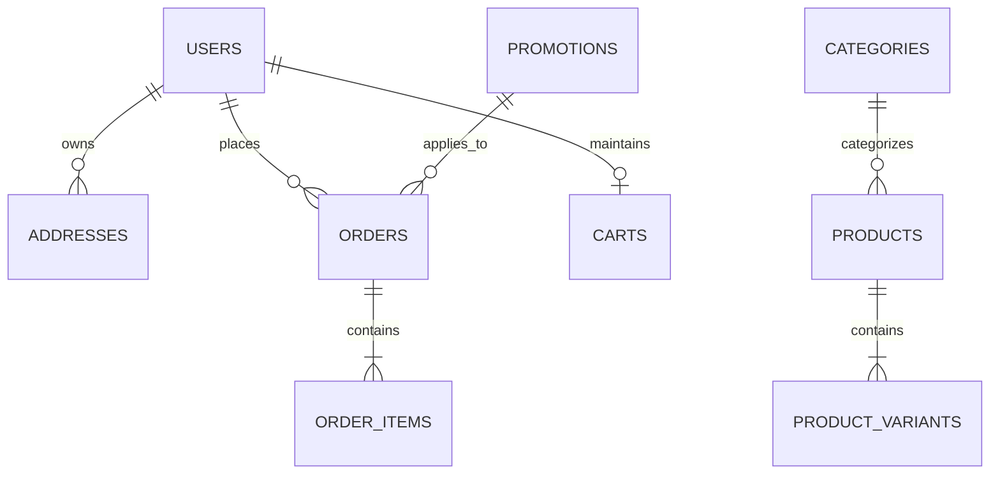

# Firebase Cloud Architecture & Security Specification (Phase Four)

This document specifies the planned production migration from the current local Service Layer to **Google Firebase** (Firebase Authentication, Cloud Firestore, Firebase Storage, and Cloud Functions).

---

## 1. Firestore Data Architecture



### 1.1 Collections & Schema Design

#### `products` Collection
- **Path**: `/products/{productId}`
- **Fields**:
  - `id`: string (doc ID)
  - `slug`: string (unique indexed)
  - `name`: string
  - `subtitle`: string
  - `description`: string
  - `categoryId`: string (ref: `categories/{id}`)
  - `categorySlug`: string
  - `categoryName`: string
  - `collectionIds`: string[]
  - `priceMinor`: integer (Minor currency units in INR paise, e.g. 149900 = ₹1,499)
  - `compareAtPriceMinor`: integer | null
  - `currency`: string ("INR")
  - `colors`: array of `{ name, slug, hex }`
  - `sizes`: string[] (e.g. `['S', 'M', 'L', 'XL']`)
  - `variants`: array of `{ id, sku, size, colorSlug, priceMinor, stock }`
  - `images`: array of `{ id, url, alt }`
  - `materials`: string
  - `care`: string
  - `badge`: string | null (`'New'`, `'Bestseller'`, `'Limited'`, `'Almost gone'`)
  - `status`: string (`'active'`, `'draft'`, `'archived'`)
  - `createdAt`: timestamp
  - `updatedAt`: timestamp

#### `categories` Collection
- **Path**: `/categories/{categoryId}`
- **Fields**: `id`, `slug`, `name`, `description`, `imageUrl`, `sortOrder`

#### `users` Collection
- **Path**: `/users/{userId}` (UID matches `request.auth.uid`)
- **Fields**:
  - `id`: string (matches Auth UID)
  - `email`: string
  - `firstName`: string
  - `lastName`: string
  - `phone`: string | null
  - `role`: string (defaults to `'customer'`; note: administrative elevation is controlled exclusively by Auth Custom Claims `token.admin === true`, never client-writable fields)
  - `createdAt`: timestamp
- **Sub-collections**:
  - `/users/{userId}/addresses/{addressId}`:
    `{ id, label, firstName, lastName, line1, line2, city, state, postalCode, country, phone, isDefault }`

#### `orders` Collection
- **Path**: `/orders/{orderId}`
- **Fields**:
  - `id`: string
  - `number`: string (e.g. `SW-2026-1052`)
  - `customerId`: string | null (UID if authenticated)
  - `email`: string
  - `items`: array of `{ productId, variantId, sku, productName, variantLabel, unitPriceMinor, quantity, lineTotalMinor, imageUrl }`
  - `shippingAddress`: map of address fields
  - `shippingMethod`: `{ id, name, priceMinor, estimatedDays }`
  - `subtotalMinor`: integer
  - `discountMinor`: integer
  - `shippingMinor`: integer
  - `totalMinor`: integer
  - `currency`: "INR"
  - `status`: string (`'pending'`, `'confirmed'`, `'processing'`, `'shipped'`, `'delivered'`, `'cancelled'`)
  - `paymentStatus`: string (`'pending'`, `'authorised'`, `'paid'`, `'failed'`, `'refunded'`)
  - `paymentIntentId`: string | null (Stripe/Razorpay payment ref)
  - `idempotencyKey`: string (unique client submission token preventing double-charging)
  - `createdAt`: timestamp

#### `inventory` Collection
- **Path**: `/inventory/{variantId}`
- **Fields**:
  - `productId`: string
  - `variantId`: string
  - `sku`: string
  - `stock`: integer
  - `reserved`: integer
  - `lowStockThreshold`: integer
  - `updatedAt`: timestamp

#### `promotions` Collection
- **Path**: `/promotions/{promoId}`
- **Fields**:
  - `code`: string (uppercase, e.g. `WELCOME10`)
  - `description`: string
  - `type`: string (`'percentage'`, `'fixed'`, `'free_shipping'`)
  - `value`: number
  - `minSubtotalMinor`: integer | null
  - `active`: boolean
  - `usageLimit`: integer | null
  - `usageCount`: integer
  - `startsAt`: timestamp | null
  - `endsAt`: timestamp | null

---

## 2. Proposed Firestore Security Rules (`firestore.rules`)

```javascript
rules_version = '2';
service cloud.firestore {
  match /databases/{database}/documents {

    // Helper: is authenticated
    function isAuthenticated() {
      return request.auth != null;
    }

    // Helper: is owner of resource
    function isOwner(userId) {
      return isAuthenticated() && request.auth.uid == userId;
    }

    // Helper: is admin (enforced via Firebase Custom Claims, NOT client-sent document attributes)
    function isAdmin() {
      return isAuthenticated() && request.auth.token.admin == true;
    }

    // Products: Public can read active items; Only admins can create/update
    match /products/{productId} {
      allow read: if resource.data.status == 'active' || isAdmin();
      allow write: if isAdmin();
    }

    // Categories: Public can read; Only admins can create/update
    match /categories/{categoryId} {
      allow read: if true;
      allow write: if isAdmin();
    }

    // Customer Profiles: Owner can read/write their own profile; Admins have read access
    match /users/{userId} {
      allow read: if isOwner(userId) || isAdmin();
      allow create: if isOwner(userId) && request.resource.data.role == 'customer';
      allow update: if isOwner(userId) && !request.resource.data.diff(resource.data).affectedKeys().hasAny(['role']);
      allow delete: if isAdmin();

      // Saved Address Book
      match /addresses/{addressId} {
        allow read, write: if isOwner(userId) || isAdmin();
      }
    }

    // Orders:
    // - Customers can read their own orders.
    // - Creation is delegated to a trusted Cloud Function (`createOrder`) to calculate prices,
    //   validate discounts, decrement stock, and verify payment. Direct client order writes are forbidden.
    match /orders/{orderId} {
      allow read: if (isAuthenticated() && resource.data.customerId == request.auth.uid) || isAdmin();
      allow create, update, delete: if isAdmin(); // Server-side Functions use Admin SDK bypassing rules
    }

    // Inventory: Public read-only; Stock mutations must be executed by Cloud Functions or Admins
    match /inventory/{variantId} {
      allow read: if true;
      allow write: if isAdmin();
    }

    // Promotions: Public read for code lookup; Admin write only
    match /promotions/{promoId} {
      allow read: if resource.data.active == true || isAdmin();
      allow write: if isAdmin();
    }
  }
}
```

---

## 3. Trusted Server-Side Cloud Functions (`functions/src/`)

Client-side orders must **never** be trusted to calculate final monetary charges or stock decrements. The following Cloud Functions handle trusted operations:

### 1. `createOrder` (HTTPS Callable)
- **Input**: `{ items: [{ variantId, quantity }], shippingAddress, shippingMethodId, promoCode, idempotencyKey }`
- **Validation**:
  1. Checks idempotency key to prevent accidental duplicate submission.
  2. Queries Firestore `products` and `inventory` using a database transaction.
  3. Verifies item quantities are within current physical stock.
  4. Recalculates exact minor units for items, applies verified promotion logic, adds carrier fee.
  5. Initializes a payment intent with the verified payment provider (Stripe/Razorpay) in minor units.
  6. Creates the order in `/orders/{id}` with `paymentStatus: 'pending'`.
  7. Returns `{ orderId, clientSecret }` for frontend payment authorization.

### 2. `handlePaymentWebhook` (HTTPS Webhook)
- **Verification**: Verifies cryptographic signature using provider webhook secret.
- **Action**:
  1. On `payment_intent.succeeded`, updates `/orders/{id}`:
     - `paymentStatus: 'paid'`
     - `status: 'confirmed'`
  2. Atomically decrements physical stock in `/inventory/{variantId}` and `/products/{productId}`.
  3. Dispatches order confirmation email via SendGrid/SES.

---

## 4. Security & Architecture Checklist

- [x] **No Client Secrets**: API keys in `.env` are strictly public Firebase Web keys. Secret keys (`STRIPE_SECRET_KEY`, `FIREBASE_SERVICE_ACCOUNT_JSON`) reside in Cloud Functions secrets manager only.
- [x] **Minor Currency Units (Paise)**: All monetary fields are integer minor units, preventing floating point rounding drift.
- [x] **Custom Claims for Admin Access**: Admin privileges require Firebase Auth token custom claims (`setCustomUserClaims(uid, { admin: true })`), preventing client-side role forgery.
- [x] **Idempotency Protection**: Every order payload carries a client-generated UUID idempotency key to reject duplicate submissions on slow networks.
- [x] **Transactional Stock Reservation**: Stock decrements execute inside Firestore transactions to prevent race conditions during high-demand drops.
